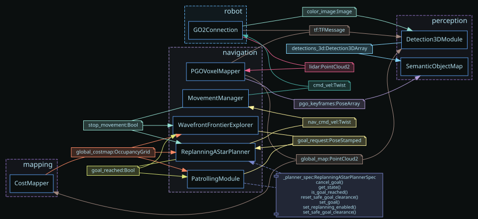

## Design

This adds a persistent 3D semantic object map for the Unitree Go2 replay. It fits into DimOS as
swappable modules joined by existing message contracts rather than a monolithic perception node:

- Prompt-free YOLO-E supplies open-vocabulary 2D instances and masks. YOLO11 remains an explicit
  faster fixed-vocabulary baseline.
- The hybrid lifter projects the calibrated accumulated LiDAR cloud into each instance mask and
  falls back to the 2D box when mask support is insufficient.
- Global one-to-one assignment prevents two observations in one frame from claiming the same map
  object.
- The temporal backend tracks active/dormant/moved lifecycle, uses conservative ResNet-18
  appearance ReID for revisits, and exposes `where_is_object()`, `navigate_to_object()`, and
  structured metrics. Navigation publishes a 1 m standoff goal to the existing Go2 A* planner.
- Pose-graph reprojection is deliberately disabled: this replay does not expose a stable,
  timestamp-matched source keyframe and detections use an accumulated global cloud. Enabling the
  earlier newest-keyframe approximation would make an unsupported geometry claim.

Detector, appearance encoder, 3D lifter, and map backend are independently factory-selected. Their
standard boundaries remain `Detection2DArray` and `Detection3DArray`, making later model/fusion
comparisons blueprint changes rather than rewrites.

The blueprint consumes DimOS's existing `color_image`, accumulated world-frame `global_map`,
camera calibration, and TF streams. It publishes the standard `Detection3DArray`, so the existing
Rerun bridge and downstream modules work without a new message type. Query, navigation, and metrics
are exposed through normal DimOS RPCs; navigation reuses the existing cost map and replanning A*
module rather than introducing another planner.

## Alternatives evaluated

- **Detection:** YOLO11 segmentation, prompt-free YOLO-E, prompted Grounding DINO, and Grounding
  DINO followed by SAM 2. YOLO-E is the default because it broadened observed vocabulary while
  maintaining the replay's online pipeline rate. YOLO11 remains the faster conservative baseline;
  DINO variants operated below 1 Hz.
- **Camera-LiDAR fusion:** box frustum, mask frustum, and hybrid mask/box lifting. The selected
  projection-based sequential fusion path transforms world LiDAR into the calibrated camera,
  selects points inside the instance mask, and retries with the 2D box when fewer than 20 points
  support the mask. Box lifting survives more often but admits background; mask lifting is tighter
  but loses sparse observations; hybrid recovered 42% of fallback attempts.
- **Association:** greedy nearest-neighbour, frame-global one-to-one assignment, and temporal
  assignment with appearance and active/dormant/moved lifecycle. The temporal backend is selected
  because it enforces same-frame exclusivity and supports conservative revisit and move handling.

Pretrained weights may download automatically on first use, per the take-home clarification. The
default YOLO-E and ResNet-18 paths already do this; the optional Grounding DINO path uses the
Hugging Face cache, and YOLO-E falls back from DimOS Git-LFS data to Ultralytics' first-use download.
The default CUDA replay is measured below. A fixed 13-frame CPU benchmark is also included and
records the database hash, frame IDs, model/package versions, cold latency, and warm latency.

## Replay proof




The screenshot shows the camera, odometry, telemetry, accumulated LiDAR map, and persistent labeled
3D objects from the temporal pipeline using the YOLO11 baseline. The final YOLO-E default was also
recorded over the complete replay and is available through Git LFS at
[`evidence/yoloe_default_replay.rrd`](https://github.com/Srrrrini/dimos-perception-takehome/blob/srinivas/feat/semantic-object-map/dimos/perception/semantic_map/evidence/yoloe_default_replay.rrd).

```text
dimos/perception/semantic_map/evidence/yoloe_default_replay.rrd
SHA-256: b96b00c157ffbdb0dd1deccf43f5f4afced0ea78e9629a6390eabd44e6422f4c
Size: 120,732,545 bytes; `rerun rrd verify` passed
```

## Results

Default YOLO-E full replay: 625 2D detections, 291 3D observations, 47 confirmed objects, and 5.44
effective Hz over the same 855-frame recording.

Additional default-pipeline details:

- 291/470 aligned detections survived 3D lifting (61.91%); 203/291 observations fused into existing
  objects (69.76%). All 291 received appearance descriptors.
- Latency: detector 34.69/51.60 ms, appearance 5.10/9.96 ms, and association 0.90/1.89 ms
  mean/p95.
- No rejected frames or detector/lifter/descriptor failures. The static replay produced no move
  events; the mapper reported two geometric loop closures, but no semantic correction is claimed.
- A detector-only GPU sample measured YOLO-E at 28.39 ms mean / 36.41 ms p95 (35.23 Hz).
- Controlled tracker simulation: 100% track recall, zero duplicates, ID switches, or false merges,
  and 1/1 moved-object re-identification across five known objects. This isolates tracking rather
  than measuring end-to-end detector recall.
- 48 focused tests pass; lint and type checking pass.

The first five rows below keep YOLO11 fixed while changing one fusion/tracking stage at a time, so
metric changes can be attributed to that stage. The final four temporal rows compare detector
front ends while keeping the preferred downstream pipeline fixed. All runs used fresh processes
and the same 855-frame, 59.80-sensor-second replay.

`3D survival` is the fraction of aligned 2D detections producing a valid 3D observation. `Accepted
fusion` is the fraction of valid observations incorporated into an existing object. `Confirmed
objects` means repeatedly observed tracks—not ground-truth accuracy or recall.

| Configuration | 2D detector | LiDAR point selection | Map association | Effective Hz | Inference mean / p95 | 3D survival | Confirmed objects | Accepted fusion |
|---|---|---|---|---:|---:|---:|---:|---:|
| Bounding-box baseline | YOLO11 bounding boxes | Points projected inside each 2D bounding-box frustum | Greedy nearest same-class object | 5.42 | 24.26 / 34.88 ms | 187/251 (74.50%) | 26 | 147/187 (78.61%) |
| Instance-mask only | YOLO11 instance masks | Points projected inside the instance mask; no fallback | Greedy nearest same-class object | 5.50 | 26.58 / 39.74 ms | 135/325 (41.54%) | 22 | 96/134 (71.64%) |
| Mask-first with bounding-box fallback | YOLO11 instance masks | Use mask when supported; otherwise retry with the 2D box | Greedy nearest same-class object | 5.44 | 27.99 / 44.65 ms | 209/301 (69.44%) | 34 | 161/207 (77.78%) |
| Frame-global assignment | YOLO11 instance masks | Mask-first with bounding-box fallback | Global one-to-one same-class assignment | 5.41 | 25.67 / 39.08 ms | 196/289 (67.82%) | 30 | 149/194 (76.80%) |
| Temporal YOLO11 baseline | YOLO11 instance masks | Mask-first with bounding-box fallback | Global assignment + ResNet appearance + active/dormant/moved lifecycle | 5.43 | 28.28 / 42.39 ms | 209/326 (64.11%) | 33 | 157/206 (76.21%) |
| **Default: temporal YOLO-E** | **YOLO-E open-vocabulary instance masks** | **Mask-first with bounding-box fallback** | **Global assignment + ResNet appearance + active/dormant/moved lifecycle** | **5.44** | **34.69 / 51.60 ms** | **291/470 (61.91%)** | **47** | **203/291 (69.76%)** |
| Prompted Grounding DINO | Grounding DINO prompted boxes | Points projected inside each 2D bounding-box frustum | Global assignment + ResNet appearance + temporal lifecycle | 0.89 | 660.94 / 665.68 ms | 273/674 (40.50%) | 72 | 113/272 (41.54%) |
| Prompted Grounding DINO + SAM | Grounding DINO boxes refined into SAM masks | Mask-first with bounding-box fallback | Global assignment + ResNet appearance + temporal lifecycle | 0.70 | 825.93 / 839.09 ms | 205/534 (38.39%) | 47 | 73/205 (35.61%) |

The replay has no ground-truth object annotations, so these are runtime, consistency, duplicate
proxy, and safety measurements—not invented precision/recall claims. A moved-object recall claim
requires an annotated move-and-revisit recording.

The team confirmed that no annotated evaluation dataset is available and suggested simulation for
accuracy evaluation. Accordingly, replay results remain evidence of runtime and internal
consistency; deterministic tracker tests cover known stationary, duplicate, revisit, and moved-object
scenarios without presenting them as end-to-end detector accuracy.

## Run and inspect

```bash
uv run dimos --replay --replay-db data/go2_short.db --viewer rerun \
  run unitree-go2-semantic-map-temporal
```

From `dimos shell`:

```python
app.SemanticObjectMap.where_is_object("chair")
app.SemanticObjectMap.navigate_to_object("chair")
app.SemanticObjectMap.get_metrics()
app.Detection3DModule.get_perception_metrics()
```

## Future work

- **Ground-truth evaluation:** annotate a small development set and a held-out test sequence, then
  report detection precision/recall, 3D center error and IoU, duplicate/merge errors, ID switches,
  fragmentation, IDF1/HOTA-style association, and `where_is_object()` success and position error.
- **Controlled simulation:** evaluate stationary revisits, identical nearby objects, occlusion,
  object movement, and navigation success across multiple scenes and random seeds with confidence
  intervals.
- **Fusion comparisons:** compare the current calibration-based mask-frustum method against
  single-scan lifting, PointPainting-style semantic points, learned frustum box estimation, and
  BEV feature fusion using identical inputs and ground truth. Measure accuracy, latency, memory,
  and sensitivity to calibration and timestamp error.
- **Vocabulary quality:** normalize YOLO-E's broad labels and evaluate prompted/open-vocabulary
  detectors on an annotated indoor-object vocabulary rather than treating detection volume as
  recall.
- **Long-term mapping:** add timestamp-matched local observations and stable keyframe IDs before
  enabling pose-graph object correction or semantic loop closure. Move appearance descriptors from
  the opaque detection ID into an explicit interoperable schema.
- **Deployment evaluation:** benchmark CPU and edge-GPU operation, dropped-frame age, p95
  sensor-to-map latency, GPU memory, and end-to-end object-navigation success. Select the final
  configuration from the held-out accuracy/runtime Pareto frontier.
