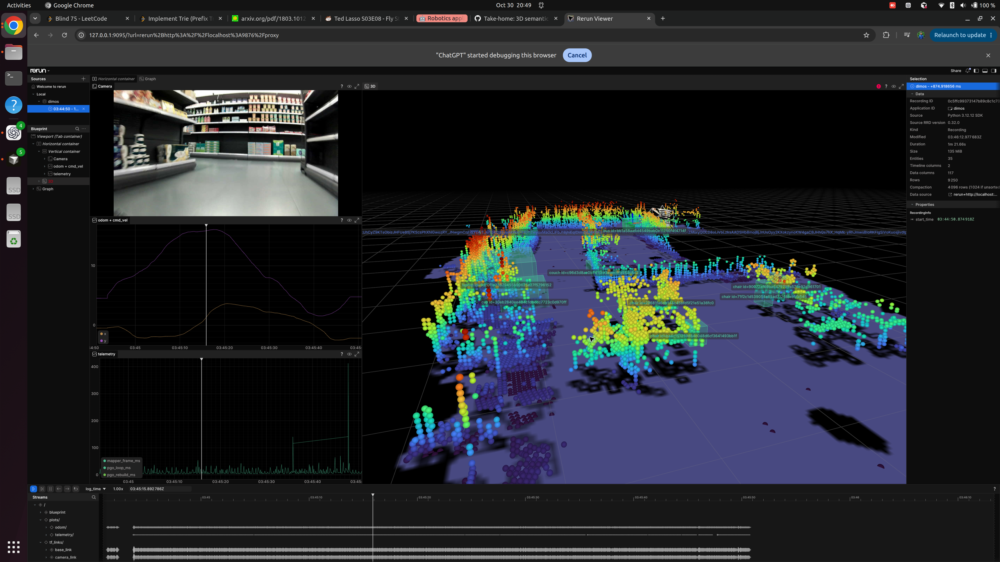

## Design

This adds a persistent 3D semantic object map for the Unitree Go2 replay. It fits into DimOS as
swappable modules joined by existing message contracts rather than a monolithic perception node:

- YOLO11 segmentation supplies 2D instances and masks.
- The hybrid lifter projects the calibrated accumulated LiDAR cloud into each instance mask and
  falls back to the 2D box when mask support is insufficient.
- Global one-to-one assignment prevents two observations in one frame from claiming the same map
  object.
- The temporal backend tracks active/dormant/moved lifecycle, uses conservative ResNet-18
  appearance ReID for revisits, and exposes `where_is_object()` plus structured metrics.
- Observations are stored in pose-graph-keyframe coordinates and reprojected after optimization,
  so loop closure corrects the semantic map instead of leaving landmarks in stale poses.

Detector, appearance encoder, 3D lifter, and map backend are independently factory-selected. Their
standard boundaries remain `Detection2DArray` and `Detection3DArray`, making later model/fusion
comparisons blueprint changes rather than rewrites.

## Replay proof



The screenshot shows the camera, odometry, telemetry, accumulated LiDAR map, and persistent labeled
3D objects from `unitree-go2-semantic-map-temporal`. A complete replay artifact was also generated
and verified:

```text
recordings/20261030-204447-6317-unitree-go2-semantic-map-temporal/rerun.rrd
SHA-256: 00fd881da11eeee07395db895637616e30aaa584fba18182064df5d316ed7791
Size: 112 MiB; 9,231 chunks; 53 entities; verification passed
```

## Results

Final metrics-only E08 replay:

- 207/207 surviving 3D detections received appearance descriptors.
- 80.19% observation-to-object association rate.
- 0.81 ms mean / 0.95 ms p95 association latency.
- 5.19 ms mean / 10.93 ms p95 appearance extraction per detection.
- 0 false move events on the static replay; rejected variants produced 7 and 4.
- Two geometric loop closures; semantic landmark corrections reached 0.110 m in E07.
- 24 focused semantic-map, appearance, and lifting tests pass; lint and type checking pass.

The replay has no ground-truth object annotations, so these are runtime, consistency, duplicate
proxy, and safety measurements—not invented precision/recall claims. A moved-object recall claim
requires an annotated move-and-revisit recording.

Detailed experiment history, including rejected trials, is in
`dimos/perception/semantic_map/EXPERIMENTS.md`.
