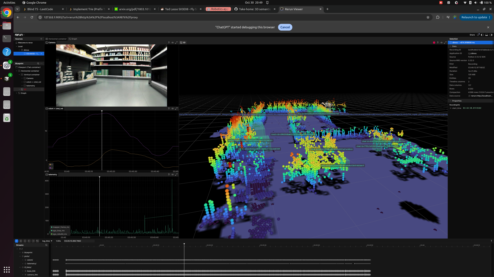
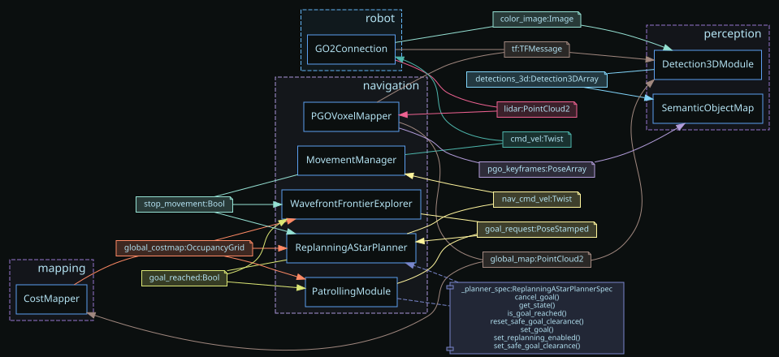

# Replay evidence





The screenshot shows the final `unitree-go2-semantic-map-temporal` blueprint replaying the Go2
recording. The left side contains the camera stream, odometry, and mapper/pose-graph timing; the
right side shows the accumulated LiDAR map and persistent labeled 3D semantic objects.

The graph is generated directly by `dimos graph unitree-go2-semantic-map-temporal --rpc`. It
verifies the blueprint's module, channel, and RPC wiring using the same registry entry used by
`dimos run`.

The full recording is intentionally not committed because it is 112 MiB. It was generated at:

```text
recordings/20261030-204447-6317-unitree-go2-semantic-map-temporal/rerun.rrd
```

Integrity:

```text
SHA-256: 00fd881da11eeee07395db895637616e30aaa584fba18182064df5d316ed7791
Rerun verification: 1 file verified without error
Rerun contents: 9,231 chunks, 53 entity paths, 9,268 rows
```

Regenerate it from the repository root with:

```bash
RERUNBRIDGEMODULE__RERUN_OPEN=none \
RERUNBRIDGEMODULE__RERUN_SAVE=1 \
uv run dimos --replay --replay-db data/go2_short.db --viewer rerun \
  run unitree-go2-semantic-map-temporal
```
